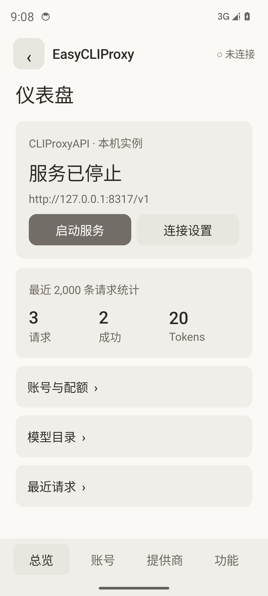
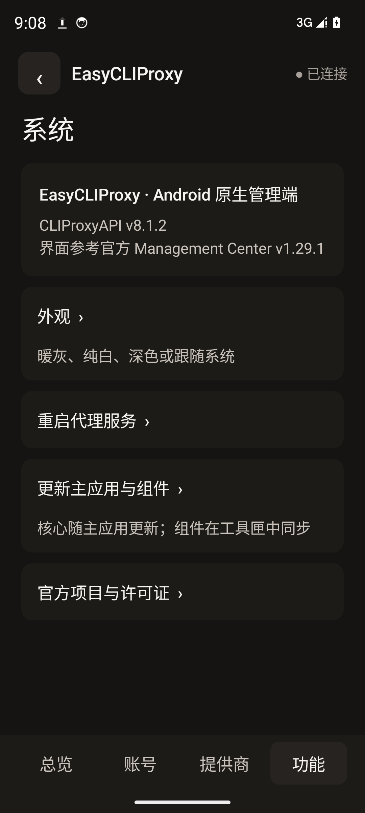

# EasyCLIProxy 4.0.0 · Android 管理中心

2026-11-24。以 [CLIProxyAPI Management Center v1.29.1](https://github.com/router-for-me/Cli-Proxy-API-Management-Center/tree/v1.29.1) 为功能和配色参考，沿用 Android 原生 View 与工具匣组件加载协议。核心升级至 [CLIProxyAPI v8.1.2](https://github.com/router-for-me/CLIProxyAPI/releases/tag/v8.1.2)。两个上游项目的 MIT 许可证随组件交付。

先覆盖安装工具匣 **0.18.1 / versionCode 29**，再同步组件仓库更新 **CLI 4.0.0 / versionCode 8**。原生核心随主 APK 更新；只更新 `.tcm` 不会替换核心。组件的最低宿主版本已设为 29。

## 功能对应

| 官方工作区 | Android 实现 |
| --- | --- |
| Dashboard | 服务状态、启停、核心版本、提供商数量、路由、最近 2,000 条请求的成功数与 Token 统计 |
| AI Providers | 八类提供商配置组、密钥池、模型映射、代理、请求头、权重；OpenAI 兼容、Claude、Gemini、xAI 支持查询上游模型并选择加入映射 |
| Auth Files | 搜索和状态筛选、批量启停/删除、导入导出、刷新凭据、解除冷却、账号字段编辑，账号卡片继续显示模型余量 |
| OAuth | Codex 设备码/浏览器、Claude、Antigravity、Kimi、Kimi AI、xAI、Devin、Meta、GitHub Copilot，以及手动回调 |
| Routing | 轮询、优先填满、加权轮询、会话粘性，重试与冷却设置 |
| Quota | 独立余量页与账号卡片共用查询和缓存；保留未知值、数量单位和重置时间，补充 Kimi AI、Meta、Devin、Copilot 协议 |
| Config | 按配置域的原生树形编辑、JSON 高级编辑；完整 YAML 搜索、导入导出、保存前对照；冲突写入明确报错 |
| Logs | 请求明细、模型和成功状态；运行日志筛选、自动刷新、导出、清空和请求错误日志下载 |
| System / Models | 可用模型搜索与复制、刷新官方模型目录、主题、重启和更新入口 |
| Plugins | 插件清单、实例配置、登录、按账号查询配额、卸载；商店仅展示声明匹配 Android 架构的安装包 |

底部保留「总览、账号、提供商、功能」四个高频入口，其余工作区集中到功能页。配色取自官方的暖灰浅色与深色主题，另提供纯白和跟随系统。编辑内容在旋转时保留，离开未保存的编辑页会提示。

本次复刻的是手机上可用的管理能力。复杂配置使用树形/JSON/YAML 编辑，没有逐项照搬网页的所有专用表单；插件自带的网页资源页面没有嵌入原生端。Harness、桌面命令行安装流程和只提供桌面二进制的插件不纳入手机功能。统计保留本机最近 2,000 条请求，不等同于官方网页完整的长期分析视图。

## 数据与核心

账号目录、加密偏好和请求数据库沿用。修复每次启动重写配置的问题，连接设置改为带版本条件的局部更新；高级配置不再因重启服务而丢失。Android 管理端保护本机监听地址、管理认证和私有数据目录。

上游配置接口用 YAML 解析 JSON 时不接受 Android 的 `\/` 转义，现已按转义对规范化，保留实际反斜杠；Go 回归测试覆盖网址和不透明插件字段。Android OAuth 返回、IPv4/IPv6 回调、Codex 设备码和 Antigravity 用户信息失败处理均随新版本重新适配，差异保存在 `modules/cli/android.patch`，版本来源见 `modules/cli/upstream.json`。

## 验证

- Android 主 APK、组件 DEX 和两个架构的原生核心构建通过；CLI Lint **0 errors / 4 warnings**。
- Go：`./internal/api`、`./internal/api/handlers/management`、`./sdk/auth` 全部通过。
- 指定模拟器 `Toolcase_AiGateway_20261017` 上 **7/7** 测试通过：核心端点与 OAuth 回调、配置与路由保存/重启、冲突和非法写入拒绝、实际核心中转的模型发现、导航/主题/旋转/大字体、请求历史迁移、余量解析和查询协议。
- APK v2 签名有效。组件清单、仓库清单和主应用更新清单 RSA 签名通过；逐项校验载荷 SHA-256、ABI、ELF PIE 与宿主最低版本；其他八个组件清单未变。
- 使用合成账号和回环 HTTP 夹具。真实第三方 OAuth 登录、真实账号额度、插件下载运行及 ARM64 真机尚未验收；ARM64 已编译并检查打包完整性。

复现：构建主应用与 `scripts/package-cli.gradle`，再执行 `scripts/verify-cli.ps1`。该脚本只操作本项目指定模拟器，不接触用户真机。截图为测试数据：

## 交付校验

- 主 APK SHA-256：`075890086a6644c4fb5171fcda1ccc5d97ffe9749ae7923a347e05de4c9d9b83`
- CLI `.tcm` SHA-256：`45e7211d3b4891b2bb4f0684fdfc4566d3f9327b636802d35e41dcbf3594281a`
